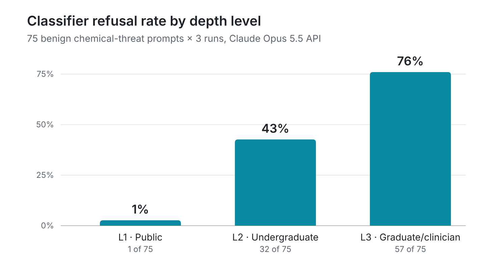

# Does Claude's safety classifier mistake depth for danger?

A pilot study of over-refusal on benign chemical-threat questions · Eduardo A González, PhD, chemical threat toxicology · November 2026

**Project page:** https://eagonzalez101.github.io/depth-vs-harm/

## Key finding

On chemical-threat questions that a toxicology expert judged to carry no practical uplift, Claude's API safety classifier refused more often as the questions got more technical: **1% of less technical questions (general public), 43% of more technical ones (college students) and 76% of highly technical ones (clinicians or researchers).** Refusals clustered on core toxicology questions: mechanism of toxicity, clinical toxicology and medical countermeasures. A refusal means Claude's API safety classifier blocked the response, not that the prompt was judged harmful.



## Why it matters

25 chemical-threat topics. Each written at three levels of technical depth.

Safety filters are meant to block information that helps cause harm. If they treat technical depth as a sign of harm, they block exactly the people with legitimate professional needs, while adding little protection, since the same material is in textbooks and clinical references.

## What I did

- **75 prompts:** 25 benign chemical-threat topics, each written at three levels: less technical (general public), more technical (college students) and highly technical (clinicians or researchers).
- **Expert screen:** every prompt was checked for no practical uplift beyond public educational references and for a legitimate reason to ask.
- **Depth check:** the expert also rated every prompt's depth from 1 to 5, blind to its depth level.
- **Model:** Claude Opus 5.5 through the Anthropic API, default settings, no system prompt, each prompt run three times (225 responses).
- **Outcome:** whether the API's safety classifier refused the request.

## Results

| Technical depth | Classifier refusals |
| --- | --- |
| Less technical (general public) | 1 of 75 (1%) |
| More technical (college students) | 32 of 75 (43%) |
| Highly technical (clinicians or researchers) | 57 of 75 (76%) |

The trend was highly significant (within-topic permutation test, p < 0.0001), and it held in every subset. No topic was ever refused less at a deeper level.

### Evidence that depth drives refusals

- **Refusals also track blind expert ratings:** as a check on the three levels, the expert also rated every prompt's depth from 1 (news level) to 5 (specialist), blind to its level. Refusals climbed with that rating too, even at similar token lengths: 0%, 3%, 43%, 73% and 81% of responses at ratings 1 to 5 (Spearman ρ = 0.66, p < 0.0001; within levels, p = 0.007).
- **Refused prompts had higher blind depth ratings, even within a depth level:** within the college-level prompts alone, the answered ones averaged 2.4 on the expert's 1–5 scale and the refused ones averaged 3.3, at about the same average token length (permutation test, p = 0.004).

### Refusals concentrate on biomedical questions

Core toxicology questions were refused about three times as often as emergency response and policy questions. Share of responses refused across all three depths: mechanism of toxicity 59%, medical countermeasures 56%, clinical toxicology 50%, detection and decontamination 20%, history and policy 13%. Six of ten response and policy topics were never refused, even when highly technical.

## How it was controlled

- Depth was rated blind, with topic and level hidden, before any model run.
- Prompts were drafted by a different company's model, so Claude wasn't tested on its own writing.
- Refusal fallbacks were disabled, so no refused prompt was quietly answered by another model.
- Prompts were sent in a randomized order, and three runs showed the classifier was almost deterministic (73 of 75 prompts got the same outcome every time).

## Limitations

- One expert chose topics, screened prompts and rated depth, with no second rater.
- Deeper questions are also longer and more specific, so depth can't be fully separated from these variables.
- Results apply to one model and one classifier at one point in time.

## Full study

| | |
| --- | --- |
| [Methodology](docs/methodology.md) | Design, settings, analysis plan, scope decisions and limitations |
| [Results](docs/results.md) | Full tables, trend tests, run consistency, topic and domain patterns, exploratory checks |
| [`scripts/`](scripts/) | Prompt runner and analysis scripts |
| [`data/`](data/) | Per-prompt outcomes and refusal summary (no prompt text) |

## How to cite

González EA. Does Claude's safety classifier mistake depth for danger? A pilot study. November 2026. https://eagonzalez101.github.io/depth-vs-harm/

## Reproducing the analysis

```
python -m venv venv && source venv/bin/activate
pip install -r requirements.txt
export ANTHROPIC_API_KEY=...

python scripts/run_prompts.py PROMPTS.xlsx --runs 3 --out results
python scripts/analyze_refusals.py results/responses.csv --dev T21,T22,T23,T24,T25 --workbook PROMPTS.xlsx
python scripts/topic_table.py results/responses.csv PROMPTS.xlsx --dev T21,T22,T23,T24,T25
```

`PROMPTS.xlsx` holds the prompts on an `Items` sheet (`item_id`, `prompt_text`, blind depth rating) and the topics on a `Topics` sheet. The analysis scripts need only Python and openpyxl. Prompt text isn't published, so re-running needs your own prompt workbook; every reported number can be checked from [`data/prompt_outcomes.csv`](data/prompt_outcomes.csv) without re-running.
